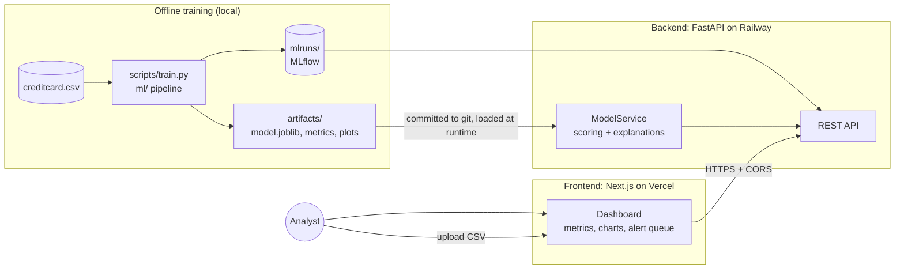

# FraudLens

**Risk operations cockpit for credit-card fraud: ranked review prioritization, not automatic fraud decisions.**

- Live dashboard: https://fraudlens-vert-seven.vercel.app/
- Live API: https://fraudlens-production-f9ef.up.railway.app/health

---

## 1. Problem Statement

Card fraud is rare but expensive. In the dataset used here only **0.17%** of 284,807 transactions are fraudulent (492 cases). Fraud teams cannot review every transaction, and plain accuracy is misleading at this imbalance, because a model that says "never fraud" is 99.83% accurate while catching nothing.

The real question is: **given a limited review capacity, which transactions should analysts look at first, and why?**

## 2. Solution Overview

FraudLens trains and compares fraud models, then serves the best one through an API and a dashboard that behaves like an analyst's work queue.

- **Honest evaluation.** Stratified train / validation / test split. The model is chosen on validation data only, and the held-out test set is used once for the final report. Average Precision (PR-AUC) is the primary metric, with ROC-AUC secondary.
- **Capacity-aware ranking.** Transactions are scored and the **top 200** highest-risk ones form the review queue, each labelled High / Medium / Review.
- **Explainable alerts.** Every alert lists the top features pushing its score up or down (XGBoost per-feature contributions), so an analyst sees why it was flagged.
- **Experiment tracking.** Every training run is logged with MLflow and shown in the dashboard.
- **Batch scoring.** Upload a CSV of transactions and get a ranked queue back.

### Results (held-out test set, 71,202 transactions, 123 frauds)

| Metric | XGBoost (selected) |
|---|---|
| Average Precision (PR-AUC) | **0.842** (random ≈ 0.002) |
| ROC-AUC | 0.980 |
| Precision / Recall / F1 at threshold 0.5 | 0.795 / 0.821 / 0.808 |
| Fraud caught in top-200 queue | **106 of 200** (precision@200 = 0.53) |
| Share of all fraud captured by the top 200 | **86.2%** (recall@200) |

Logistic regression reaches AP 0.690 and an all-negative dummy catches no fraud.

> Risk scores are uncalibrated ranking scores, not probabilities. The split is random, not chronological, so live performance would likely be lower.

## 3. Architecture Diagram



The model has no separate service: it is a file in `artifacts/` that the API loads on first use.

### API endpoints

| Method | Path | Purpose |
|---|---|---|
| GET | `/health` | Service and model status |
| GET | `/api/v1/model/info` | Selected model and test metrics |
| GET | `/api/v1/metrics` | Held-out test metrics |
| GET | `/api/v1/evaluation` | Full evaluation report |
| GET | `/api/v1/eda/summary` | Dataset exploration summary |
| GET | `/api/v1/experiments` | MLflow runs |
| GET | `/api/v1/artifacts/{name}` | Whitelisted plots and the top-200 CSV |
| POST | `/api/v1/predict` | Score one transaction |
| POST | `/api/v1/alerts/upload` | Score a CSV and return the ranked queue |

Interactive docs are at `/docs` on the API.

## 4. Technology Stack

| Layer | Technology |
|---|---|
| ML | scikit-learn, XGBoost, pandas, NumPy, joblib |
| Experiment tracking | MLflow |
| Backend | FastAPI, Uvicorn, Pydantic |
| Frontend | Next.js 15, React 19, TypeScript, Tailwind CSS, Recharts |
| Testing | pytest, httpx |
| Deployment | Vercel (frontend), Railway (backend + model) |

## 5. Setup and Installation Instructions

### Prerequisites
- Python 3.12
- Node.js 18+ and npm
- The credit-card fraud dataset (`Time`, `V1`–`V28`, `Amount`, `Class`) saved as `data/raw/creditcard.csv`. It is not stored in git. It is only needed to retrain or regenerate the EDA summary.

### Project layout

```
backend/     FastAPI app and tests
ml/          Data loading, training, evaluation, explanations, MLflow helpers
scripts/     train.py, verify_dataset.py
artifacts/   Trained model, metrics, plots (committed)
mlruns/      MLflow tracking store (committed)
frontend/    Next.js dashboard
```

### Run locally

**1. Backend**
```powershell
python -m venv .venv
.venv\Scripts\activate
pip install -r backend/requirements.txt
python -m uvicorn backend.app.main:app --port 8000
```
The pre-trained model in `artifacts/` is used, so no training is needed. Check `http://localhost:8000/health`.

**2. Frontend** (second terminal)
```powershell
cd frontend
npm install
npm run dev
```
Open `http://localhost:3000`. The frontend calls `http://localhost:8000` unless `NEXT_PUBLIC_API_URL` is set.

### Retrain the model (optional)
```powershell
python scripts/verify_dataset.py   # regenerates artifacts/eda_summary.json
python scripts/train.py            # trains, evaluates, logs to MLflow, writes artifacts/
```

### Run the tests
```powershell
python -m pytest
```

### Configuration

| Variable | Where | Default | Purpose |
|---|---|---|---|
| `FRAUDLENS_CORS_ORIGINS` | Backend | `http://localhost:3000` | Comma-separated allowed frontend origins |
| `FRAUDLENS_ARTIFACT_DIR` | Backend | `artifacts` | Location of model and reports |
| `FRAUDLENS_MAX_UPLOAD_BYTES` | Backend | `52428800` | CSV upload size limit (50 MB) |
| `FRAUDLENS_DATA_PATH` | Backend | `data/raw/creditcard.csv` | Training dataset path |
| `MLFLOW_TRACKING_URI` | Backend | `file:./mlruns` | MLflow store |
| `NEXT_PUBLIC_API_URL` | Frontend | `http://localhost:8000` | Backend URL, baked in at build time |

### CSV upload format
Columns `Time`, `V1`–`V28` and `Amount`, with **no `Class` column**. The API rejects labelled files so a target can never leak into scoring. At most 200 alerts are returned, highest risk first.

### Deployment

**Backend (Railway)**
1. Push the repo to GitHub, then create a Railway project from the repo (root directory = repo root).
2. `requirements.txt`, `.python-version` and `railway.json` configure the install, start command (`uvicorn backend.app.main:app --host 0.0.0.0 --port $PORT`) and `/health` check.
3. Set `FRAUDLENS_CORS_ORIGINS` to your Vercel URL, with no trailing slash.
4. Generate a public domain under Settings → Networking.

**Frontend (Vercel)**
1. Import the same repo and set **Root Directory** to `frontend`.
2. Set `NEXT_PUBLIC_API_URL` to the Railway URL, with no trailing slash.
3. Deploy. Redeploy whenever the API URL changes.

The model ships with the backend because `artifacts/` is committed. After retraining, commit the new `artifacts/` and `mlruns/` and push.

## 6. Business Benefits

- **Fewer missed frauds for the same effort.** Reviewing only 200 alerts captures 86% of fraud in the test set, and about half of reviewed alerts are real fraud, versus roughly 0.17% for random review.
- **Efficient use of analyst time.** A ranked queue with High / Medium / Review labels puts the riskiest cases first.
- **Trust and auditability.** Each alert comes with human-readable reasons, and every experiment is tracked, which supports model governance.
- **Realistic expectations.** Metrics suited to imbalanced data, a clean held-out test set and explicit caveats avoid overstating performance.
- **Low operating cost.** A small model file served by a lightweight API runs on inexpensive hosting without GPUs or a separate model server.
- **Human in the loop.** Scores prioritize review and never block a transaction on their own.

## 7. Future Enhancements

- Time-based train / validation / test splits and drift monitoring.
- Probability calibration, and a configurable decision threshold based on the cost of a missed fraud versus a false alarm.
- Analyst feedback loop (confirm / dismiss alerts) feeding scheduled retraining.
- Real-time scoring through streaming ingestion instead of CSV uploads.
- Authentication, role-based access and an audit log of reviewed alerts.
- Model registry and CI/CD that retrains, tests and promotes models automatically.
- Richer explanations (for example SHAP plots) and additional models such as LightGBM or a stacked ensemble.
- Containerization with Docker and a database for persisted alert history.
